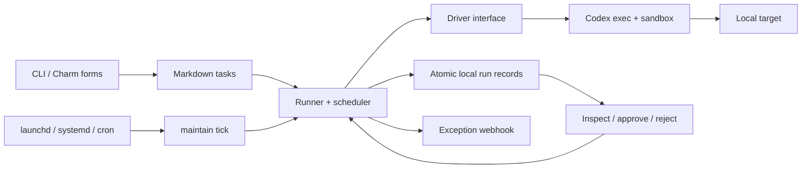

# Architecture

Maintainer owns recurring responsibility and execution bookkeeping. The agent
harness owns reasoning, model communication, authentication, and tools.



## Package boundaries

- `cmd/maintain`: argument parsing, Charm forms, human and JSON output.
- `internal/maintainer/task.go`: strict Markdown/YAML definitions and schedule parsing.
- `store.go`: atomic JSON persistence, task files, process lock, interrupted recovery.
- `engine.go`: scheduling, transitions, approval checks, notification delivery.
- `driver.go`: the small adapter interface and Codex process/result handling.

These are deliberately files in one cohesive package, rather than a framework of
public interfaces. The driver is injectable to test the lifecycle without a model.

## State

```text
maintainer/
  tasks/<name>.md
  schedule/<name>.json
  runs/<run-id>/
    run.json
    task.md
    prompt.txt
    schema.json
    result.json
    events.jsonl
    stderr.log
  lock
```

New directories are mode 0700 and records are 0600. Writes use a temporary file,
fsync, rename, and directory fsync. Store the state on a local filesystem; shared
network filesystems are not supported. Back up the directory as a unit. Atomic
records avoid a database dependency; SQLite becomes appropriate if indexing,
concurrent workers, or an outbox makes cross-record transactions necessary.

The execution lock serializes tasks and approvals within one state directory.
Its descriptor is inherited by the agent to reduce the chance of overlapping
work if the parent process dies. Independent state directories do not coordinate.
Do not point them at the same target. Read-only listing does not acquire the lock.

## Scheduling and failure behavior

`tick` is one-shot. First discovery (and edits to a definition) registers the next
future occurrence. It does not immediately execute newly registered tasks.
Manual runs also establish the next due time. Due work runs once, even if the
machine missed many occurrences. The next occurrence is computed after completion,
so long or failed jobs cannot produce a retry storm. Intervals are completion-based.

The worker is serial: a slow task delays later tasks. Overlapping ticks exit
quietly. A paused task does not run; a pending approval blocks fresh inspections.
Malformed definitions stop a tick so configuration errors are visible.

Each dispatch records `running` before starting the subprocess. Completion records
a validated outcome; the process exit code alone is insufficient. Timeouts and
SIGINT/SIGTERM cancellation kill the process group. On the next locked operation,
orphaned `running` records become `interrupted`. A hard kill or power loss may
interrupt multiple-file bookkeeping; run metadata is the audit source of truth.
Detached grandchildren are outside process-group cleanup guarantees. Agents are
instructed not to start background processes.

Approval is consumed before dispatch and cannot be replayed after partial failure.
This intentionally favors explicit review over an automatic retry of a possibly
already-applied change.

## Permission boundaries

The initial adapter uses Codex's existing OS sandbox, not a custom isolation layer.

- Observe/propose/ask inspection: `read-only`, no agent shell network access.
- Auto/approved execution: `workspace-write`; network disabled unless `network: true`.
- Approval prompts inside Codex are disabled (`approval_policy=never`); Maintainer
  does not silently escalate or fall back to unrestricted execution.
- User config and execpolicy rules are ignored. Targets with project
  `.codex/config.toml` in their ancestor chain are rejected because that config can
  add tools outside the shell sandbox. Web search is disabled.
- The process receives only a small environment allowlist. Agent shells do not
  inherit service tokens, webhook URLs, or login-shell configuration.
- State and targets may not contain one another; workspace writes must not reach
  Maintainer's approval ledger. Symlink-resolved paths are checked too.

This is a **local write sandbox**, not complete confidentiality isolation: Codex
may read files allowed by its own sandbox policy, and the model receives context
from the target. The agent harness itself is trusted and can write its own auth,
logs, and output artifacts. Installed system/managed Codex policies are also trusted;
administrative policies can take precedence over CLI settings. Review those policies
on managed machines. Other software running as the same user can alter the ledger.

An approved plan is not a mechanically enforced list of commands. It grants a
separate workspace-write run instructed to execute that plan. The sandbox limits
where shell writes occur; it does not prove the agent followed every semantic
constraint. Git approval checks bind the tracked commit and clean worktree, not
ignored files, mutable remote resources, or the entire machine environment.

Enabling network access is consequential: filesystem restrictions do not limit
remote HTTP/SSH operations. The initial implementation does not provide remote
read-only credentials or command capabilities. Do not treat an objective saying
"inspect only" as protection for an unrestricted server credential. Live server
maintenance needs a future adapter with narrowly scoped remote access.

## Deliberate next steps

1. Validate a real local compatibility check and repository proposal over time.
2. Add isolated Git worktrees for proposed patches, with diff-based application.
3. Add scoped remote inspection/action adapters before live server upgrades.
4. Add notification retry/retention policies and more drivers when needed.
5. Add a Bubble Tea history/review view if plain commands become awkward.

Primary documentation consulted:
[Codex non-interactive mode](https://learn.chatgpt.com/docs/non-interactive-mode),
[Codex CLI implementation](https://github.com/openai/codex/blob/main/codex-rs/exec/src/cli.rs),
[Huh v2 migration](https://github.com/charmbracelet/huh/blob/main/UPGRADE_GUIDE_V2.md),
[robfig/cron](https://github.com/robfig/cron),
[Go exec](https://pkg.go.dev/os/exec).
